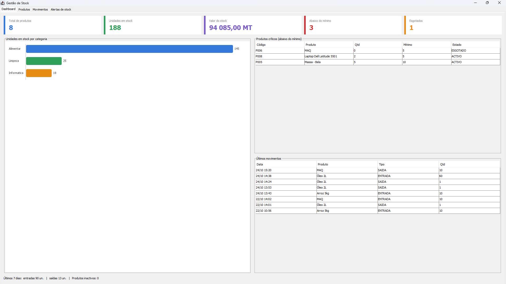
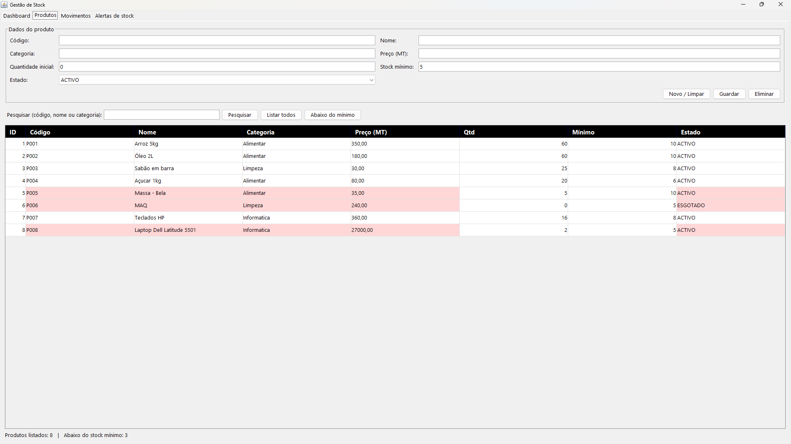
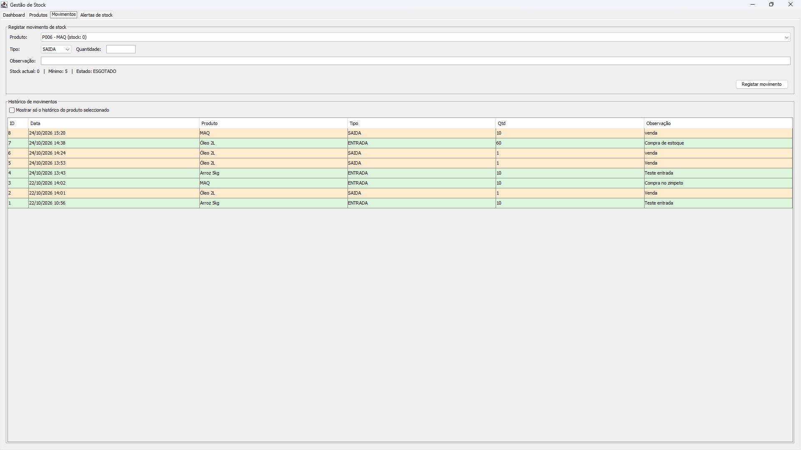
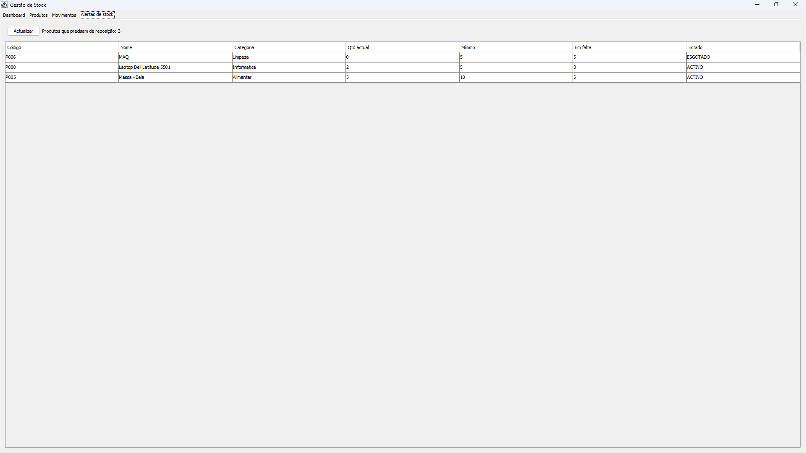

<h1 align="center">📦 Sistema de Gestão de Stock</h1>

<p align="center">
  Aplicação desktop em <b>Java Swing</b> com <b>MySQL</b> para controlo de produtos, entradas e saídas de stock e alertas de reposição.
</p>

<p align="center">
  
  
  
  
  
</p>

---

## 👥 Autores

Projecto desenvolvido **em grupo** no âmbito de um trabalho académico (Teste 2).

| Autor | GitHub |
|---|---|
| **Leximíbel Langa** | [@leximibellanga](https://github.com/leximibellanga) |
| **António Mucavele** | [@tonnymuca27-glitch](https://github.com/tonnymuca27-glitch) |

---

## 📖 Sobre o projecto

O enunciado propunha uma aplicação desktop de gestão de stock em **C# e Windows Forms**. Com autorização do docente, a solução foi desenvolvida em **Java (Swing)**, plataforma equivalente para interfaces desktop orientadas a eventos.

A aplicação permite registar, consultar, pesquisar, actualizar e eliminar produtos, controlar entradas e saídas de stock, validar os estados dos produtos e identificar os que estão abaixo do stock mínimo. Os dados são guardados numa base de dados SQL (MySQL).

---

## ✨ Funcionalidades

- **📊 Dashboard (tela inicial):** cartões de resumo (produtos, unidades, valor do stock, abaixo do mínimo, esgotados), gráfico de barras por categoria, produtos críticos, últimos movimentos e resumo dos últimos 7 dias.
- **📦 Produtos:** CRUD completo, pesquisa por código, nome ou categoria, filtro "abaixo do mínimo" e destaque a vermelho dos produtos em alerta.
- **🔄 Movimentos:** entradas e saídas com observação, histórico filtrável por produto e avisos automáticos de produto esgotado ou abaixo do mínimo.
- **⚠️ Alertas:** lista dos produtos a repor com a quantidade em falta.
- **✅ Validações:** código único, preço e quantidades não negativas, stock nunca negativo e produtos inactivos bloqueados para movimentos.

### Regras de negócio

| Regra | Descrição |
|---|---|
| Código único | Não podem existir dois produtos com o mesmo código |
| Stock não negativo | Uma saída maior que o stock disponível é recusada |
| Rastreabilidade | A quantidade só muda através de entradas e saídas |
| Estado automático | Quantidade 0 → `ESGOTADO`; ao repor stock → `ACTIVO` |
| Produto `INACTIVO` | Não pode ser movimentado |
| Alerta | Produto em alerta quando `quantidade < stock mínimo` |

---

## 🖼️ Capturas de ecrã

> Substituir pelas capturas reais (guardar em `docs/img/`).

| Dashboard | Produtos |
|---|---|
|  |  |

| Movimentos | Alertas |
|---|---|
|  |  |

---

## 🧱 Arquitectura

A aplicação segue uma arquitectura em camadas:

```
view (Swing)  →  dao (acesso a dados)  →  MySQL
      ↓                 ↓
          modelo (entidades e regras)
          excecao (excepções personalizadas)
          util (ligação à BD)
```

```
GestaoStock/
├── src/
│   ├── dao/
│   │   ├── DashboardDAO.java
│   │   ├── MovimentoDAO.java
│   │   └── ProdutoDAO.java
│   ├── excecao/
│   │   ├── StockInsuficienteException.java
│   │   └── ValidacaoException.java
│   ├── modelo/
│   │   ├── EstadoProduto.java
│   │   ├── Movimento.java
│   │   ├── Produto.java
│   │   ├── ResumoStock.java
│   │   └── TipoMovimento.java
│   ├── util/
│   │   └── Conexao.java
│   └── view/
│       ├── Actualizavel.java
│       ├── JanelaPrincipal.java
│       ├── Main.java
│       ├── PainelAlertas.java
│       ├── PainelDashboard.java
│       ├── PainelMovimentos.java
│       └── PainelProdutos.java
├── database/
│   └── gestao_stock.sql
└── README.md
```

### Conceitos aplicados

- **POO:** encapsulamento, enumerações, validação nos setters, regras de negócio no modelo, interface `Actualizavel` e polimorfismo.
- **Programação orientada a eventos:** `ActionListener`, `ListSelectionListener` e `ChangeListener`; interface iniciada na *Event Dispatch Thread*.
- **Tratamento de excepções:** excepções personalizadas (`ValidacaoException`, `StockInsuficienteException`), `SQLException` tratada na interface e `try-with-resources`.
- **Integridade dos dados:** movimentos em **transacção** (`commit`/`rollback`) com `SELECT ... FOR UPDATE`.
- **Segurança:** `PreparedStatement` em todas as consultas (previne SQL Injection).

---

## 🗄️ Modelo de dados

```
produtos (1) ────< (N) movimentos
```

**`produtos`:** `id`, `codigo` (único), `nome`, `categoria`, `preco`, `quantidade`, `stock_minimo`, `estado` (`ACTIVO`, `INACTIVO`, `ESGOTADO`), `data_registo`.

**`movimentos`:** `id`, `produto_id` (FK), `tipo` (`ENTRADA`, `SAIDA`), `quantidade`, `observacao`, `data_movimento`.

O script completo está em [`database/gestao_stock.sql`](database/gestao_stock.sql).

---

## 🚀 Como executar

### Pré-requisitos

- [JDK 8 ou superior](https://www.oracle.com/java/technologies/downloads/)
- [NetBeans](https://netbeans.apache.org/)
- [XAMPP](https://www.apachefriends.org/) (MySQL)
- Driver `mysql-connector-j` (incluído no NetBeans como *MySQL JDBC Driver*)

### Passo a passo

**1. Clonar o repositório**

```bash
git clone https://github.com/leximibellanga/gestao_de_stock_cpv.git
```

**2. Criar a base de dados**

1. Abre o XAMPP e inicia **Apache** e **MySQL**.
2. Vai a `http://localhost/phpmyadmin`.
3. No separador **SQL**, executa o conteúdo de `database/gestao_stock.sql`.

**3. Abrir no NetBeans**

1. `File > Open Project` e selecciona a pasta do projecto.
2. Em *Libraries*, confirma que o **MySQL JDBC Driver** está adicionado (`Add Library... > MySQL JDBC Driver`).

**4. Configurar a ligação (se necessário)**

Em `src/util/Conexao.java`, por defeito a ligação usa `root` sem palavra-passe, que é o padrão do XAMPP:

```java
private static final String URL = "jdbc:mysql://localhost:3306/gestao_stock?useSSL=false&serverTimezone=UTC";
private static final String USER = "root";
private static final String PASSWORD = "";
```

**5. Executar**

Botão direito em `view/Main.java` → **Run File** (`Shift + F6`).

---

## 🛠️ Resolução de problemas

| Problema | Solução |
|---|---|
| `Driver MySQL não encontrado` | Adicionar o *MySQL JDBC Driver* às bibliotecas do projecto |
| `Communications link failure` | Iniciar o **MySQL** no XAMPP |
| `Unknown database 'gestao_stock'` | Executar o script `database/gestao_stock.sql` |
| `Access denied for user 'root'` | Ajustar `USER` e `PASSWORD` em `Conexao.java` |
| Porta diferente de 3306 | Alterar a porta no `URL` de `Conexao.java` |

---

## 🔮 Melhorias futuras

- [ ] Autenticação de utilizadores e perfis (administrador e operador)
- [ ] Relatórios em PDF e Excel
- [ ] Gestão de fornecedores e vendas
- [ ] Leitura de código de barras
- [ ] Configuração da ligação à BD por ficheiro externo

---

## 🎓 Contexto académico

| | |
|---|---|
| **Disciplina** | Complementos de Programacao Visual |
| **Docente** | [nome do docente] |
| **Instituição** | Universidade Tecnica Diogo Eugenio Guilande |
| **Ano** | 2026 |

---

<p align="center">
  Desenvolvido por <a href="https://github.com/leximibellanga"><b>Leximíbel Langa</b></a>
  e <a href="https://github.com/tonnymuca27-glitch"><b>António Mucavele</b></a> 🇲🇿
</p>